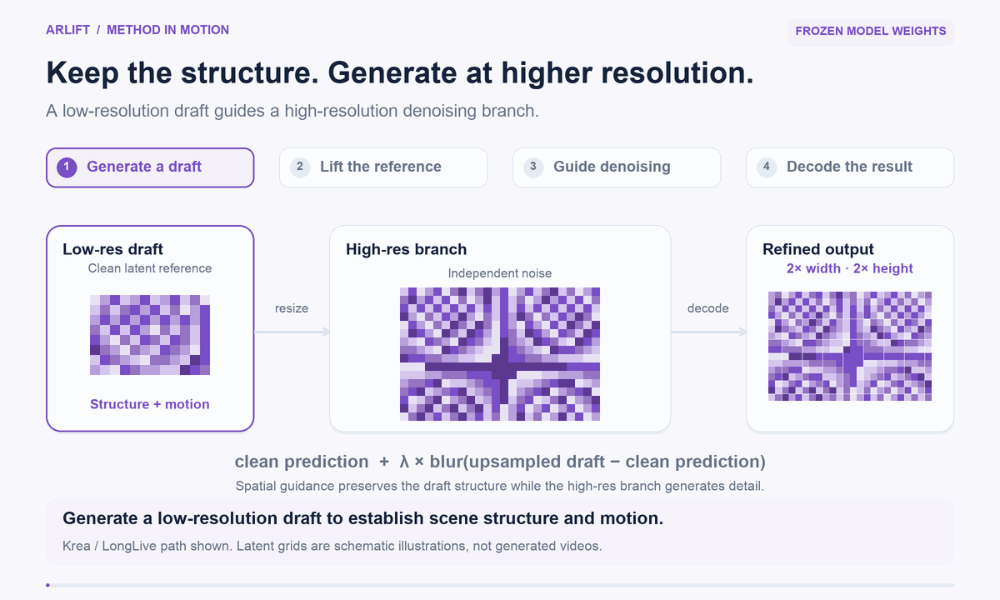

# ARLIFT

<a id="authors"></a>

**👥 Authors:** [Gezhi Zhu](https://github.com/TetuDegit)<sup>1</sup> · [Xuemei Zhou](https://www.cwi.nl/en/people/xuemei-zhou/)<sup>2</sup> · [Teng Long](https://tenglon.github.io/)<sup>3</sup> · [Vincent Tao Hu](https://taohu.me/)<sup>1</sup>

<sup>1</sup> School of Software Engineering, Huazhong University of Science and Technology<br>
<sup>2</sup> Centrum voor Wiskunde en Informatica (CWI)<br>
<sup>3</sup> University of Trento

[🌐 Project website](https://vibe-hust.github.io/arlift_page/) · <a href="https://github.com/vibe-hust/arlift_code"><picture><source media="(prefers-color-scheme: dark)" srcset="docs/assets/github-mark-white.svg"></picture> Code repository</a> · [📄 Paper](https://vibe-hust.github.io/arlift_page/ARLIFT-paper.pdf)

**High-resolution video generation with low-resolution draft guidance.** ARLIFT generates a low-resolution draft and uses its structure to guide a second pass at twice the width and height. This repository contains the inference code, model-specific settings, and scripts for downloading the pinned checkpoints.


<a id="method-in-motion"></a>

## 🎬 Method in motion



The Krea/LongLive autoregressive guidance path is shown here. MiniMax uses a separate refinement pipeline.

[Static overview](docs/assets/method-overview.png) · [Animation source and notes](docs/method-animation.md)

| Backbone | Draft → output (width × height) | Output clip | Weight download |
| --- | --- | --- | --- |
| [Krea Realtime 14B](#krea-realtime-14b) | 832 × 480 → 1664 × 960 | 112 frames at 16 fps | ~41 GB |
| [LongLive 2.0 5B](#longlive-20-5b) | 1280 × 704 → 2560 × 1408 | 112 frames at 16 fps | ~44 GB |
| [MiniMax-H3 Ref2VA](#minimax-h3-ref2va) | 1344 × 768 → 2688 × 1536 | 124 frames at 24 fps, with audio from the draft | ~216 GB from text, ~146 GB with an existing draft |

<a id="getting-started"></a>

## 🚀 Getting started

```bash
git clone https://github.com/vibe-hust/arlift_code.git
cd arlift_code
```

Choose one backbone and run its commands from the repository root. All three default generation paths were tested on a single Linux node with two NVIDIA H100 GPUs (about 64 GiB visible per device) and the listed checkpoints. The tests used prepared environments and verified the exported frame size, frame count, frame rate, and MiniMax audio track.

Krea and LongLive share a Python 3.11 environment and require FFmpeg with `libx264` on `PATH`. MiniMax uses a separate Python 3.12 environment. The examples use two visible GPUs on one machine.

To preview a run before downloading weights, install PyYAML in your active Python environment. These commands run on CPU and show the resolved settings, the prompt, and the pinned checkpoints with their destinations.

```bash
python -m pip install PyYAML==6.0.3
python krea_14b/generate.py --describe
python download_weights.py krea_14b --list
```

For the other backbones, replace `krea_14b` in both commands with `longlive_5b` or `minimax_h3_ref2va`.

<a id="krea-realtime-14b"></a>

## 🎬 Krea Realtime 14B

Set up the causal-model environment with a CUDA 12.8-compatible driver and the CUDA toolkit for building FlashAttention.

```bash
python3.11 -m venv .venv-ar
source .venv-ar/bin/activate
python -m pip install --upgrade pip setuptools wheel packaging ninja psutil
python -m pip install torch==2.8.0+cu128 torchvision==0.23.0+cu128 --index-url https://download.pytorch.org/whl/cu128
```

```bash
python -m pip install --no-build-isolation -r krea_14b/requirements.txt
python download_weights.py krea_14b
CUDA_VISIBLE_DEVICES=0,1 torchrun --standalone --nproc-per-node=2 krea_14b/generate.py \
  --prompt-file examples/prompt.txt --output outputs/krea.mp4
```

Krea finishes all ten draft blocks of three latent frames before starting the high-resolution pass. Each block’s final clean estimate guides the matching high-resolution block. Between denoising stages, Krea adds noise to the corrected estimate using its native scheduler. The FP16 decoder trims three leading display frames and writes 112 frames. [Krea configuration](krea_14b/inference.yaml)

<a id="longlive-20-5b"></a>

## 🎥 LongLive 2.0 5B

If starting with LongLive, run the first setup block under Krea to create `.venv-ar` and install PyTorch. Then install the LongLive dependencies and generate a clip.

```bash
source .venv-ar/bin/activate
python -m pip install --no-build-isolation -r longlive_5b/requirements.txt
python download_weights.py longlive_5b
CUDA_VISIBLE_DEVICES=0,1 torchrun --standalone --nproc-per-node=2 longlive_5b/generate.py \
  --prompt-file examples/prompt.txt --output outputs/longlive.mp4
```

LongLive generates four blocks of eight latent frames per branch. The fourth UniPC update ends at the smallest positive noise level in the schedule. A model call at timestep zero gives the fifth, final clean prediction. A separate call refreshes the attention cache. The BF16 decoder exports the first 112 frames. [LongLive configuration](longlive_5b/inference.yaml)

For a single-GPU run with either causal model, launch its `generate.py` with `CUDA_VISIBLE_DEVICES=0 python` in place of `CUDA_VISIBLE_DEVICES=0,1 torchrun --standalone --nproc-per-node=2`.

<a id="minimax-h3-ref2va"></a>

## 🎞️ MiniMax-H3 Ref2VA

Use two visible GPUs on one machine, a CUDA 12.9-compatible driver, Git, and the system `patch` tool. The text encoder has a configured memory budget of 48 GiB per GPU. The transformer also uses host RAM for offloading. Apply and verify the two bundled Diffusers patches after installation.

```bash
python3.12 -m venv .venv-h3
source .venv-h3/bin/activate
python -m pip install --upgrade pip
python -m pip install -r minimax_h3_ref2va/requirements.txt
python minimax_h3_ref2va/tools/apply_diffusers_patches.py
python minimax_h3_ref2va/tools/apply_diffusers_patches.py --check
```

To generate a video from text, download the weights for both passes. The first pass generates a lossless Pika-H3-Flex RGB and audio draft. The second pass refines the video with the MiniMax-H3 Ref2VA transformer and HyperFlow adapter. The output carries the draft audio.

```bash
python download_weights.py minimax_h3_ref2va
CUDA_VISIBLE_DEVICES=0,1 torchrun --standalone --nproc-per-node=2 minimax_h3_ref2va/generate.py \
  --prompt-file examples/prompt.txt --output outputs/minimax.mp4
```

To refine an existing draft, supply a **1344 × 768** video with **124 frames at 24 fps** and its matching text via `--prompt` or `--prompt-file`. If the draft was generated with a different seed, pass that seed with `--seed`. Audio is optional. The smaller download below contains just the components used for refinement.

```bash
python download_weights.py minimax_h3_ref2va --existing-draft
CUDA_VISIBLE_DEVICES=0,1 torchrun --standalone --nproc-per-node=2 minimax_h3_ref2va/generate.py \
  --draft /path/to/draft.mp4 --prompt-file /path/to/matching_prompt.txt \
  --output outputs/minimax_from_draft.mp4
```

MiniMax uses bidirectional attention with Ref2VA draft conditioning. It guides the video prediction in the first four of eight HyperFlow steps with weights of approximately 1.0000, 0.3839, 0.1744 and 0.0735. The final four weights are zero. For the paper’s paired comparison, give both methods the same draft, prompt and seed. [MiniMax configuration](minimax_h3_ref2va/inference.yaml)

<a id="writing-prompts"></a>

## ✍️ Writing prompts

Use a detailed prompt for a single continuous shot rather than a short caption. For English prompts, about 60 words in three sentences is a good starting point, as in the tested example below. This is a recommendation, not a minimum length. ARLIFT uses the low-resolution draft to guide the high-resolution pass, so describe one main action that fits the clip and make the subject, motion, and camera behavior explicit.

1. **Scene and subject.** Name the main subject, its setting, and the objects that matter in the frame.
2. **Action.** Describe what moves, how it moves, and which parts of the scene stay still.
3. **Camera and appearance.** Specify the framing, whether the camera is fixed or moving, and a few visible details such as lighting or materials.

The [bundled example](examples/prompt.txt) is the first prompt in the 24-prompt evaluation set used for Krea and LongLive:

> A woman sits beside a sunlit window in a modest living room with a sofa, a wooden table, and a leafy plant. She slowly turns her head toward the window while keeping her hands relaxed in her lap. The camera remains fixed in a medium shot, showing natural skin, cotton fabric, warm wood, and clear daylight in one continuous take.

Use `--prompt-file path/to/prompt.txt` for a UTF-8 text file containing one prompt, or pass text directly with `--prompt`. Text-to-video runs use the bundled example when neither option is given. The three configurations default to seed `610009`, which you can override with `--seed`. To compare two prompt versions, keep the backbone, generation settings, and seed fixed.

With this example, the default settings, and the two-H100 setup above, the published inference code reproduced the Krea and LongLive evaluation MP4s byte for byte. MiniMax also generated the example successfully from text.

## Reproducing the paper settings

**Spatial guidance and memory.** Krea and LongLive bilinearly resize each clean draft block to the high-resolution latent grid with `align_corners=False`. At each guided stage, they subtract the high-resolution clean prediction from that reference, filter the difference with a 13 × 13 Gaussian (σ = 1 latent pixel, reflection padding), and add it back to the prediction with the stage weight. Filtering and fusion use FP32. The five stage weights are `[1, 1/3, 1/9, 0, 0]`. Each branch keeps one first-frame anchor, two summaries and four recent latent frames. The long and short summaries use update weights of 0.01 and 0.1. [Guidance implementation](arlift/guidance.py)

**Random seeds.** The low- and high-resolution branches draw separate noise tensors at their own resolutions using the same base seed (default `610009`). Krea seeds each block with `seed + 1000003 * block_index`, counting from zero, then continues that stream for re-noising. LongLive resets the generator to `seed` at the start of each branch, draws one noise tensor for the full branch, and slices it into blocks.

**Evaluation windows.** The release includes the three 2× generation paths and one of the 24 prompts used for the causal backbones. Repeating the paper’s full comparisons also requires the remaining evaluation inputs, baseline outputs and scoring code. The frame indices below refer to decoded RGB frames, count from zero and include both endpoints.

| Paper comparison | Frames scored per clip |
| --- | --- |
| Krea main comparison | Score 0–31 and 40–71 separately, then average the two scores equally |
| LongLive main comparison | 24–63 |
| LongLive component ablation | 56–71 |
| MiniMax paired comparison | 0–123 for each of the 12 draft pairs |

For Krea and LongLive, generation writes the full MP4 at H.264 CRF 16. The evaluation extracts the listed windows from that export using lossless H.264 (QP 0) at 16 fps and the original dimensions.

<a id="weights-and-outputs"></a>

## 📦 Weights and outputs

- Checkpoints go under `weights/<backbone>/` by default. On another disk, give each backbone its own directory, for example `--weights-dir /mnt/models/krea_14b`, and pass that same path to the download and generation commands. [Weight manifest](arlift/weights.json)
- Use `--list` with the download command to inspect sources before downloading. Use `--describe` on a generation command to validate and print its resolved configuration, or `--check-weights` to verify that the files and indexed shards exist. These checks run on CPU. For a refinement-only MiniMax installation, use `--check-weights` with `--draft /path/to/draft.mp4` and its matching prompt.
- `--output` selects the MP4 path. Existing files are protected. With `--config` you can pass a copy of a model's YAML. The dimensions, block lengths and schedules shipped here correspond to the paper settings.

To check an export against the dimensions, frame count and frame rate in the backbone table, inspect its streams with FFprobe. For a MiniMax export, `codec_type` also shows whether the draft’s audio track was carried over.

```bash
ffprobe -v error -show_entries stream=codec_type,width,height,avg_frame_rate,nb_frames \
  -of json outputs/krea.mp4
```

<a id="acknowledgments"></a>

## 🙏 Acknowledgments

We thank the authors and maintainers of the projects and models used by ARLIFT:

- **Autoregressive backbones:** [Krea Realtime Video](https://github.com/krea-ai/realtime-video), [Wan](https://github.com/Wan-Video/Wan2.1), and [LongLive](https://github.com/NVlabs/LongLive).
- **Attention memory:** [MemRoPE](https://github.com/YoungRaeKimm/MemRoPE), whose memory mechanism informs the LiteMem adaptation.
- **Draft and refinement components:** [Pika-H3-Flex](https://github.com/Pika-Labs/Pika-H3-Flex), [MiniMax H3](https://huggingface.co/MiniMaxAI/MiniMax-H3), and the [Open-H3-Regenerate / HyperFlow integration](https://huggingface.co/Efficient-Large-Model/Open-H3-Regenerate-2K-IC).
- **Runtime libraries:** [PyTorch](https://github.com/pytorch/pytorch) and [Diffusers](https://github.com/huggingface/diffusers).

The [third-party notices](THIRD_PARTY_NOTICES.md) record source revisions and adaptations. Powered by MiniMax H3.

<a id="citation"></a>

## 📚 Citation

If you use this work or code, please cite:

```bibtex
@misc{zhu2026arlift,
  title  = {{ARLIFT: Training-Free Resolution Extrapolation for Few-Step Autoregressive Video Generation}},
  author = {Zhu, Gezhi and Zhou, Xuemei and Long, Teng and Hu, Vincent Tao},
  year   = {2026},
  url    = {https://github.com/vibe-hust/arlift_code}
}
```

A machine-readable citation is available in [CITATION.cff](CITATION.cff).

<a id="attributions-and-licenses"></a>

<a id="license"></a>

## 📄 License

ARLIFT contains components with different licenses. The repository does not declare a single license covering all code and model weights.

| Component | License or terms |
| --- | --- |
| Krea-derived components | [CC BY-NC-SA 4.0](licenses/Krea-Realtime.md) |
| Wan and LongLive code | [Wan Apache 2.0](licenses/Wan-Apache-2.0.txt) and [LongLive Apache 2.0](licenses/LongLive.txt) |
| Pika-H3-Flex inference code and patches | [Apache 2.0](licenses/Pika-H3-Flex/LICENSE-CODE) |
| MiniMax H3 works | [MiniMax H3 Community License](licenses/Pika-H3-Flex/licenses/MiniMax-H3-LICENSE.txt) |
| Open-H3-Regenerate components | [Model license](licenses/Open-H3-Regenerate/LICENSE), [Qwen license](licenses/Open-H3-Regenerate/LICENSE-Qwen.txt), and [notice](licenses/Open-H3-Regenerate/NOTICE) |

See [THIRD_PARTY_NOTICES.md](THIRD_PARTY_NOTICES.md) for the component mapping and the separate model-weight terms, including LongLive's NVIDIA Open Model License. The downloader's pinned model sources are recorded in [arlift/weights.json](arlift/weights.json).
